

<a href="https://orc.tools"><picture><source media="(prefers-color-scheme: dark)" srcset="img/banner-night.webp">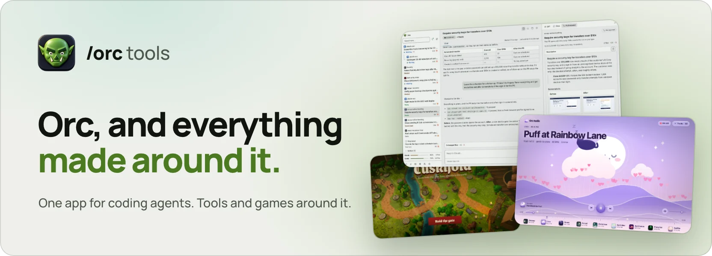</picture></a>

<a href="https://orc.tools">orc.tools</a> · <a href="https://orc.orc.tools">Orc</a> · <a href="https://movie.orc.tools">Orc: the movie</a> · <a href="https://radio.orc.tools">Orc Radio</a>

## Orc

<a href="https://orc.orc.tools"><picture><source media="(prefers-color-scheme: dark)" srcset="img/orc-night.webp">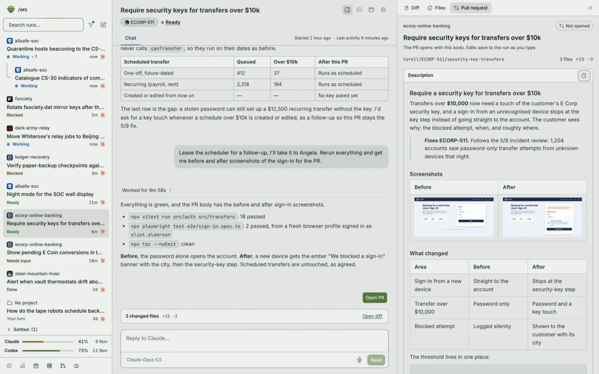</picture></a>

**Prompt in. Pull request out.** Orc is an app for running coding agents such as Claude Code and Codex. A prompt or a ticket becomes one route, Plan, Build, Ship, and every run builds on its own branch. Nothing is pushed or merged until you click.

Orc is private for now. [See it at orc.orc.tools](https://orc.orc.tools) or [watch the film](https://movie.orc.tools).

## Tools

<a href="https://radio.orc.tools"><picture><source media="(prefers-color-scheme: dark)" srcset="img/orc-radio-night.webp">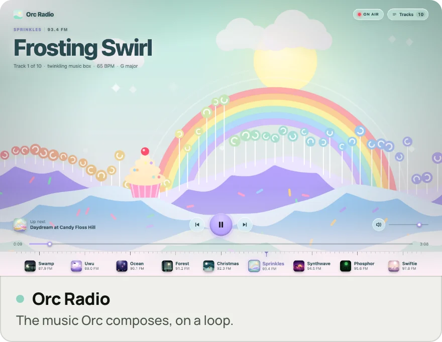</picture></a>
<a href="https://orc.tools/projects/mcp-manager"><picture><source media="(prefers-color-scheme: dark)" srcset="img/mcp-manager-night.webp">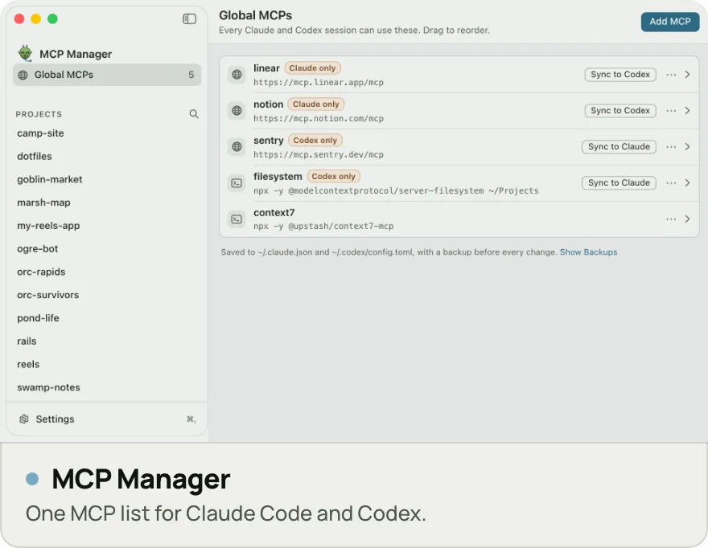</picture></a>
<a href="https://ds.orc.tools"><picture><source media="(prefers-color-scheme: dark)" srcset="img/orc-design-system-night.webp">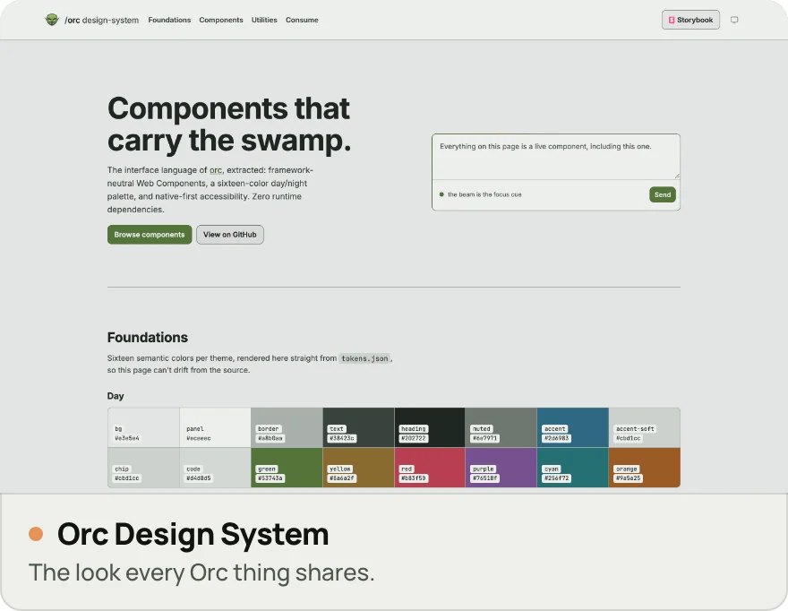</picture></a>
<a href="https://tokenizer.orc.tools"><picture><source media="(prefers-color-scheme: dark)" srcset="img/orc-tokenizer-night.webp">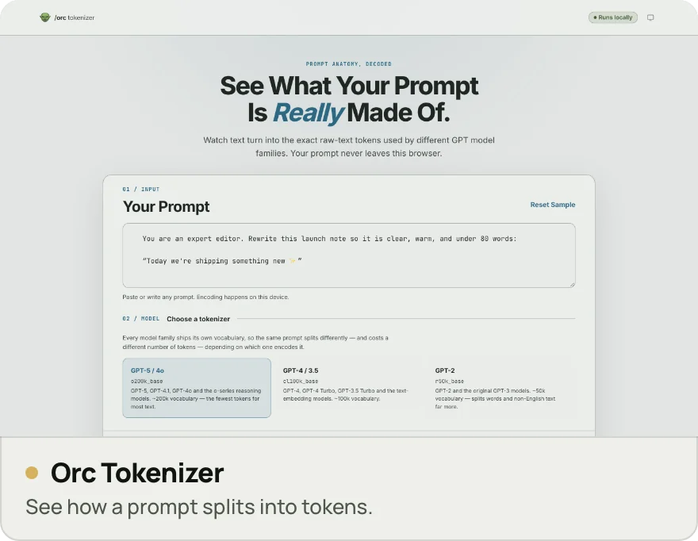</picture></a>

## Games

<a href="https://flags.orc.tools"><picture><source media="(prefers-color-scheme: dark)" srcset="img/orc-flags-night.webp">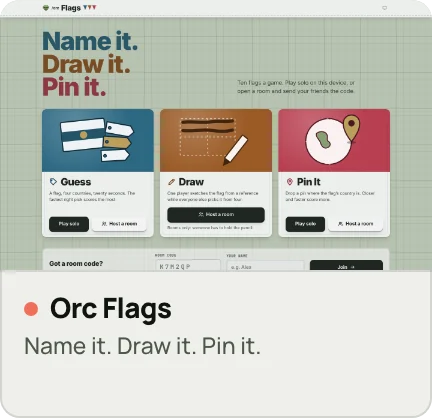</picture></a>
<a href="https://orcrapids.com"><picture><source media="(prefers-color-scheme: dark)" srcset="img/orc-rapids-night.webp">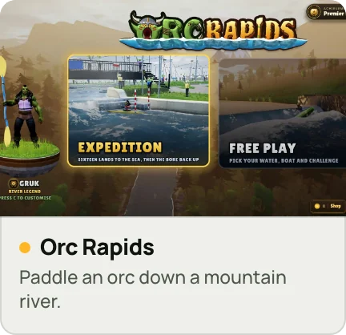</picture></a>
<a href="https://survivors.orc.tools"><picture><source media="(prefers-color-scheme: dark)" srcset="img/orc-survivors-night.webp">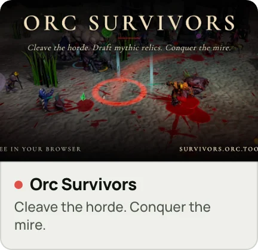</picture></a>
<a href="https://tower2.orc.tools"><picture><source media="(prefers-color-scheme: dark)" srcset="img/tuskhold-night.webp">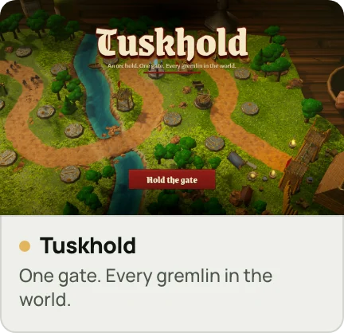</picture></a>
<a href="https://swamp.orc.tools"><picture><source media="(prefers-color-scheme: dark)" srcset="img/swamp-simulator-night.webp">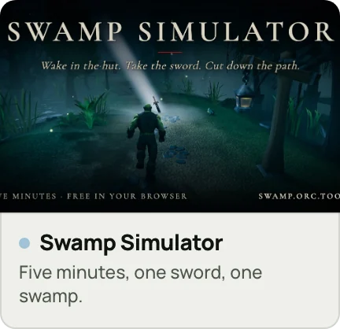</picture></a>
<a href="https://shibuya.orc.tools"><picture><source media="(prefers-color-scheme: dark)" srcset="img/orc-shibuya-night.webp">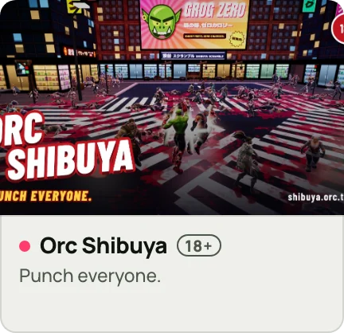</picture></a>
<a href="https://fibbage.orc.tools"><picture><source media="(prefers-color-scheme: dark)" srcset="img/orc-fibs-night.webp">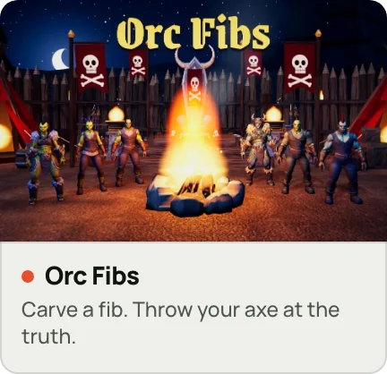</picture></a>
<a href="https://spymaster.orc.tools"><picture><source media="(prefers-color-scheme: dark)" srcset="img/orc-spymaster-night.webp">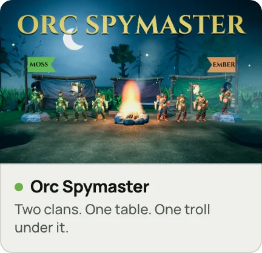</picture></a>

